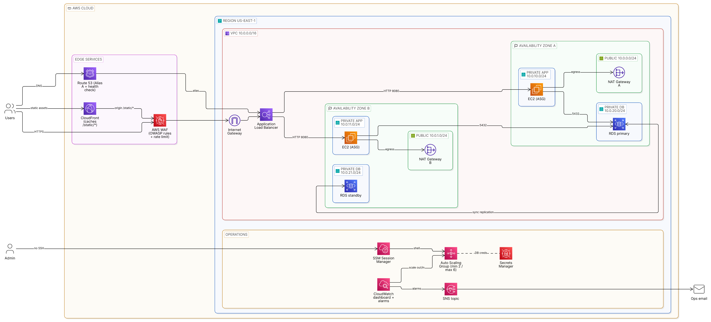

# Scalable Web Application with ALB and Auto Scaling

A production-grade, highly available web application architecture on AWS. EC2 instances run in private subnets across two Availability Zones behind an Application Load Balancer protected by AWS WAF. An Auto Scaling Group sizes the fleet automatically, CloudFront caches static assets at the edge, and a Multi-AZ Amazon RDS database provides automatic failover. Operators reach instances only through Systems Manager Session Manager. There are no bastion hosts and no open SSH ports.

**Table of contents**

- [Solution overview](#solution-overview)
- [Architecture diagram](#architecture-diagram)
- [Architecture details](#architecture-details)
  - [Request flow](#request-flow)
  - [AWS services in this solution](#aws-services-in-this-solution)
  - [Network design](#network-design)
  - [Security](#security)
  - [High availability and scaling](#high-availability-and-scaling)
  - [Monitoring and alerting](#monitoring-and-alerting)
- [Deployment guide](#deployment-guide)
- [Validation and testing](#validation-and-testing)
- [Cost estimate](#cost-estimate)
- [Cleanup](#cleanup)
- [Learning outcomes](#learning-outcomes)
- [References](#references)

---

## Solution overview

| Goal | How the architecture meets it |
|------|-------------------------------|
| **High availability** | Every tier runs in two AZs: the ALB, one NAT Gateway per AZ, EC2 instances spread by the ASG, and an RDS primary with a synchronous standby. |
| **Scalability** | The ASG uses target tracking (average CPU 50%) for steady load and step scaling for sudden spikes. |
| **Security** | Three-tier subnets, least-privilege security groups, NACLs, WAF managed rules for the OWASP Top 10, TLS at the ALB, encrypted storage, and secrets kept in Secrets Manager. |
| **Performance** | CloudFront serves `/static/*` from edge locations, which takes that load off the ALB and the instances. |
| **Operability** | Session Manager gives audited shell access without SSH. CloudWatch dashboards and alarms report to the on-call email through SNS. |

## Architecture diagram

> Editable source: [Eraser diagram](https://app.eraser.io/workspace/aZTadkRTwzNBbGXsFnkq?diagram=JyxrhR4AU56sDk2x-jU_&layout=canvas)

The Application Load Balancer is a single regional resource whose nodes sit in **both** public subnets. The Auto Scaling Group spans **both** private app subnets.

## Architecture details

### Request flow

1. A user resolves `app.example.com`. A **Route 53** alias A record returns the ALB's addresses.
2. The HTTPS request enters the VPC through the **Internet Gateway**. **AWS WAF** inspects it before the **ALB** handles it.
3. The ALB terminates TLS with an **ACM** certificate. It forwards the request over HTTP on port 8080 to a healthy **EC2** target in either AZ.
4. The instance reads its database credentials from **Secrets Manager** and queries the **RDS** primary on port 5432.
5. Pages reference static assets (CSS, JS, images) through the **CloudFront** domain. On a cache miss, CloudFront fetches `/static/*` from the ALB. The origin request carries a secret `X-Origin-Verify` header, and an ALB listener rule rejects `/static/*` requests that lack it.
6. Instances reach the internet for OS and package updates through the **NAT Gateway** in their own AZ. The database subnets have no internet route at all.

### AWS services in this solution

| Service | Role | Key configuration |
|---------|------|-------------------|
| **Amazon VPC** | Network isolation | `10.0.0.0/16`, 2 AZs × 3 subnet tiers, IGW, 2 NAT Gateways, per-tier route tables and NACLs |
| **Amazon EC2** | Web/app servers | Launch Template: Amazon Linux 2023, `t3.micro`, IMDSv2 required, encrypted gp3 root volume, IAM instance profile, user data that installs and starts the app |
| **EC2 Auto Scaling** | Elastic capacity | min 2 / desired 2 / max 6, private app subnets in both AZs, ELB health checks, 120 s warm-up, rolling instance refresh |
| **Elastic Load Balancing (ALB)** | Layer 7 load balancing | Internet-facing in public subnets; HTTP:80 → redirect to HTTPS:443; target group HTTP:8080 with `/health` checks |
| **AWS WAF** | Web application firewall | Regional web ACL attached to the ALB, AWS managed rule groups plus a rate-based rule |
| **Amazon CloudFront** | CDN for static assets | ALB origin (HTTPS only), `/static/*` behavior with the `CachingOptimized` policy, custom origin header |
| **Amazon RDS** | Relational database | PostgreSQL 16, `db.t4g.micro`, **Multi-AZ**, gp3 storage with autoscaling, encrypted, 7-day automated backups, master password managed in Secrets Manager |
| **Amazon Route 53** | DNS and health checks | Alias A record to the ALB (evaluate target health), HTTPS health check on `/health` |
| **AWS Certificate Manager** | TLS certificates | Public certificate for `app.example.com`, DNS-validated through Route 53 |
| **AWS Systems Manager** | Instance access | Session Manager through the `AmazonSSMManagedInstanceCore` instance policy, with no SSH key pair and no port 22 |
| **AWS Secrets Manager** | Credentials | RDS-managed master user secret with automatic rotation |
| **Amazon CloudWatch** | Observability | Dashboard, metric alarms, detailed (1-minute) EC2 monitoring, RDS log exports, WAF metrics |
| **Amazon SNS** | Notifications | Topic with an email subscription for alarms and Auto Scaling launch/terminate events |
| **AWS IAM** | Access control | EC2 instance role: SSM core, CloudWatch agent, `secretsmanager:GetSecretValue` on the DB secret only |

### Network design

| Tier | AZ A | AZ B | Route table | Hosts |
|------|------|------|-------------|-------|
| Public | `10.0.0.0/24` | `10.0.1.0/24` | `0.0.0.0/0 → IGW` | ALB nodes, NAT Gateways |
| Private app | `10.0.10.0/24` | `10.0.11.0/24` | `0.0.0.0/0 → NAT Gateway in the same AZ` | EC2 instances (ASG) |
| Private DB | `10.0.20.0/24` | `10.0.21.0/24` | local only (no internet route) | RDS primary / standby |

Each private app subnet uses its own AZ's NAT Gateway, so losing one AZ does not cut off egress for the other.

#### Security groups (stateful, reference-based)

| Security group | Inbound | Outbound |
|----------------|---------|----------|
| `alb-sg` | TCP 80, 443 from `0.0.0.0/0` | TCP 8080 to `app-sg` |
| `app-sg` | TCP 8080 from `alb-sg` | TCP 443 to `0.0.0.0/0` (updates, SSM, Secrets Manager); TCP 5432 to `db-sg` |
| `db-sg` | TCP 5432 from `app-sg` | none |

#### Network ACLs (stateless, subnet-level second layer)

| NACL | Inbound allow | Outbound allow |
|------|---------------|----------------|
| Public | TCP 80, 443 from `0.0.0.0/0`; all from `10.0.0.0/16` (traffic to the NAT Gateway); TCP 1024-65535 from `0.0.0.0/0` (return traffic) | All |
| Private app | TCP 8080 from the public subnet CIDRs; TCP 1024-65535 from `0.0.0.0/0` (return traffic via NAT and from RDS) | All |
| Private DB | TCP 5432 from the private app CIDRs | TCP 1024-65535 to the private app CIDRs |

Every NACL ends with the default `*` deny rule.

### Security

- **No public compute.** Instances and the database have no public IPs. Only the ALB and the NAT Gateways sit in public subnets.
- **WAF rules (OWASP Top 10 coverage):**

  | Priority | Rule | Protects against |
  |----------|------|------------------|
  | 0 | Rate-based rule: 2,000 requests / 5 min per IP → block | HTTP floods, brute force |
  | 1 | `AWSManagedRulesAmazonIpReputationList` | Known malicious IPs and bots |
  | 2 | `AWSManagedRulesCommonRuleSet` | XSS, path traversal, oversized payloads, and other common OWASP vectors |
  | 3 | `AWSManagedRulesKnownBadInputsRuleSet` | Log4Shell, exploit payloads |
  | 4 | `AWSManagedRulesSQLiRuleSet` | SQL injection |

- **Encryption.** TLS 1.2+ at the ALB (`ELBSecurityPolicy-TLS13-1-2-2021-06`) and at CloudFront. RDS forces SSL connections. EBS volumes, RDS storage and backups are encrypted with KMS.
- **Secrets.** No passwords live in user data, AMIs or code. RDS stores the master password in Secrets Manager and rotates it automatically.
- **Instance hardening.** IMDSv2 is required (blocks SSRF-style credential theft). No SSH key pair is assigned. Session Manager logs every session to CloudTrail and can stream session output to CloudWatch Logs or S3.
- **ALB hardening.** `drop_invalid_header_fields` is enabled. Direct `/static/*` access without the CloudFront origin header gets a fixed `403`.

### High availability and scaling

| Failure or event | What happens |
|------------------|--------------|
| An instance fails its health check | The ALB stops routing to it after 3 failed checks. The ASG (ELB health check type) replaces it. |
| A whole AZ fails | The ALB routes only to the healthy AZ. The ASG launches replacements in the remaining AZ. That AZ's NAT Gateway keeps egress working. |
| The RDS primary fails | RDS promotes the synchronous standby and flips the DNS endpoint, usually within 60-120 s, with no data loss. The app reconnects to the same endpoint. |
| Traffic grows gradually | **Target tracking** keeps the ASG's average CPU near **50%** by adding or removing instances. |
| Traffic spikes suddenly | **Step scaling** fires when the CloudWatch alarm `CPU ≥ 70%` stays in breach for 2 × 1-minute periods: **+1** instance for 70-85%, **+2** for ≥ 85%. |
| Load drops | Target tracking scales in gradually, down to the minimum of 2 (one per AZ). |

The `/health` endpoint is deliberately **shallow**: it does not query the database. A database failover therefore cannot make the ALB mark every instance unhealthy at once.

### Monitoring and alerting

**CloudWatch dashboard widgets:** ALB request count, target response time (p50/p95), HTTP 4xx/5xx counts, healthy/unhealthy host count, ASG in-service instances and average CPU, RDS CPU / connections / free storage / replica lag, WAF allowed vs. blocked requests.

**Alarms → SNS email:**

| Alarm | Condition |
|-------|-----------|
| ALB target 5xx | `HTTPCode_Target_5XX_Count` sum > 10 in 5 min |
| Unhealthy targets | `UnHealthyHostCount` > 0 for 2 consecutive minutes |
| High latency | `TargetResponseTime` p95 > 1 s for 5 min |
| RDS CPU | `CPUUtilization` > 80% for 10 min |
| RDS storage | `FreeStorageSpace` < 2 GiB |
| Route 53 health check | `HealthCheckStatus` < 1 (us-east-1 metric) |
| ASG high CPU | `CPUUtilization` ≥ 70%, which also triggers the step scaling policy |

The ASG also publishes `EC2_INSTANCE_LAUNCH` / `EC2_INSTANCE_TERMINATE` notifications to the same SNS topic.

---

## Deployment guide

The steps use the AWS Management Console in **us-east-1**. Build in this order, because each step depends on the previous ones.

### Prerequisites

- An AWS account with administrator access
- A registered domain with a Route 53 public hosted zone (for example `example.com`). Without a domain you can skip the ACM/Route 53 steps and use the ALB DNS name over HTTP.
- An email address for alarm notifications

### 1. VPC and networking

1. **VPC → Create VPC → "VPC and more"**: name `webapp`, IPv4 CIDR `10.0.0.0/16`, **2 AZs**, **2 public + 4 private subnets**, NAT gateways **1 per AZ**, VPC endpoints *None*.
2. Adjust the subnet CIDRs to match the [network design](#network-design) table and give them clear names (`public-a`, `app-a`, `db-a`, …).
3. Edit the route tables. Each app subnet routes `0.0.0.0/0` to its own AZ's NAT Gateway. The DB subnets get a route table that has **only** the local route.
4. Create three **Network ACLs** (`public-nacl`, `app-nacl`, `db-nacl`) with the rules from the NACL table and associate each one with its subnets.

### 2. Security groups

Create `alb-sg`, `app-sg` and `db-sg` as shown in the security group table. Reference the other security groups (not CIDRs) wherever the table names a security group.

### 3. Database (RDS Multi-AZ)

1. **RDS → Subnet groups → Create**: `webapp-db`, choose the two **DB** subnets.
2. **RDS → Create database**: Standard create, **PostgreSQL 16**, template *Production* (or *Dev/Test* with **Multi-AZ DB instance** chosen manually).
   - DB instance class `db.t4g.micro`, storage gp3 20 GiB, storage autoscaling up to 100 GiB
   - Credentials: **Managed in AWS Secrets Manager**
   - VPC `webapp`, subnet group `webapp-db`, public access **No**, security group `db-sg`
   - Initial database name `appdb`, backups 7 days, encryption enabled, log export `postgresql`
3. Note the endpoint and the secret ARN.

### 4. IAM role for EC2

Create the role `webapp-ec2-role` (trusted entity: EC2) with:

- `AmazonSSMManagedInstanceCore`
- `CloudWatchAgentServerPolicy`
- An inline policy that allows `secretsmanager:GetSecretValue` on the RDS secret ARN only

### 5. Launch Template

**EC2 → Launch Templates → Create**:

- AMI: Amazon Linux 2023 (x86_64), instance type `t3.micro`
- Key pair: **Don't include** (access goes through Session Manager)
- Network: no subnet (the ASG chooses), security group `app-sg`
- Storage: gp3, **encrypted**
- Advanced: IAM instance profile `webapp-ec2-role`, metadata version **V2 only (token required)**, detailed CloudWatch monitoring **enabled**
- User data: installs the runtime, deploys the app, and starts it on port 8080. The app serves `/health`, `/` (reads and writes RDS) and `/static/*`. Pass the DB endpoint, secret ARN and CloudFront domain as environment variables.

### 6. Target group and Application Load Balancer

1. **Target group**: type *Instances*, HTTP **8080**, VPC `webapp`. Health check path `/health`, healthy threshold 2, unhealthy threshold 3, interval 15 s, success code 200. Deregistration delay 30 s.
2. **ACM**: request a public certificate for `app.example.com` and validate it through DNS (*Create records in Route 53*).
3. **ALB**: internet-facing, IPv4, both **public** subnets, security group `alb-sg`.
   - Listener **HTTP:80** → *Redirect to HTTPS:443 (301)*
   - Listener **HTTPS:443** → forward to the target group, ACM certificate, policy `ELBSecurityPolicy-TLS13-1-2-2021-06`
   - Attributes: enable **Drop invalid header fields**
4. HTTPS listener rules:

   | Priority | Conditions | Action |
   |----------|-----------|--------|
   | 10 | Path `/static/*` **AND** header `X-Origin-Verify` = `<secret>` | Forward to the target group |
   | 20 | Path `/static/*` | Fixed response `403` |
   | default | – | Forward to the target group |

### 7. Auto Scaling Group

1. **Create Auto Scaling group** from the launch template. Subnets: both **private app** subnets.
2. Attach it to the target group. Health check type **ELB**, grace period 120 s. Enable group metrics collection.
3. Capacity: desired 2, min 2, max 6.
4. Scaling policies:
   - **Target tracking**: metric *Average CPU utilization*, target **50**, instance warm-up 120 s.
   - **Step scaling** (add it after creating the group, under *Automatic scaling → Create dynamic scaling policy*): create the CloudWatch alarm `CPUUtilization ≥ 70` (average, 1 min, 2 datapoints) for the ASG, then add steps **70-85 → +1** and **≥ 85 → +2**.
5. Notifications: send launch/terminate events to the SNS topic (created in step 11, or create it now).

### 8. AWS WAF

**WAF & Shield → Web ACLs → Create**: resource type *Regional*, region us-east-1, associate the ALB. Add the managed rule groups and the rate-based rule from the [WAF table](#security) in that priority order. Default action **Allow**. Enable CloudWatch metrics and sampled requests.

### 9. CloudFront

**Create distribution**:

- Origin: `app.example.com` (the ALB alias), protocol **HTTPS only**, TLSv1.2
- Origin custom header: `X-Origin-Verify: <secret>`, the same value as the ALB rule
- Default behavior: *CachingDisabled*, origin request policy *AllViewerExceptHostHeader*, redirect HTTP → HTTPS
- Additional behavior: path `/static/*`, cache policy **CachingOptimized**, compression on
- Price class: *North America and Europe*

### 10. Route 53

1. Hosted zone `example.com` → **Create record**: `app`, type A, **Alias → Application Load Balancer**, region us-east-1, **Evaluate target health: Yes**.
2. **Health checks → Create**: endpoint by domain name `app.example.com`, protocol HTTPS, path `/health`, request interval 30 s, failure threshold 3. Create an alarm that notifies the SNS topic.

### 11. CloudWatch and SNS

1. **SNS → Create topic** `webapp-alerts` (Standard) → create an email subscription and **confirm it** from your inbox.
2. **CloudWatch → Alarms**: create the alarms from the [alarm table](#monitoring-and-alerting) with the action *Notify `webapp-alerts`*.
3. **CloudWatch → Dashboards → Create** `webapp` and add the widgets listed above.

---

## Validation and testing

| # | Test | How | Expected result |
|---|------|-----|-----------------|
| 1 | Load balancing across AZs | `for i in $(seq 10); do curl -s https://app.example.com/ \| grep -o 'i-[0-9a-f]*'; done` | Responses come from instances in both AZs |
| 2 | HTTPS redirect | `curl -I http://app.example.com/` | `301` to `https://` |
| 3 | CloudFront caching | `curl -I https://<dist>.cloudfront.net/static/style.css` twice | Second response: `x-cache: Hit from cloudfront` |
| 4 | Origin protection | `curl -I https://app.example.com/static/style.css` | `403` (no origin header) |
| 5 | WAF: SQL injection | `curl -I "https://app.example.com/?id=1%27%20OR%20%271%27=%271"` | `403`, visible in WAF sampled requests |
| 6 | WAF: XSS | `curl -I "https://app.example.com/?q="` | `403` |
| 7 | Session Manager | EC2 → instance → **Connect → Session Manager** (or `aws ssm start-session --target i-…`) | Shell opens with no key pair and no port 22 |
| 8 | Scale out | In a Session Manager shell: `for i in $(seq $(nproc)); do yes > /dev/null & done` (or run a load test such as `hey -z 10m -c 50 https://app.example.com/`) | The CPU alarm fires, the ASG adds instances, and SNS emails a launch notification |
| 9 | Scale in | `pkill yes` / stop the load test | The ASG returns to 2 instances after cooldown |
| 10 | Self-healing | Terminate one instance | The ALB drains it and the ASG launches a replacement |
| 11 | RDS failover | RDS → database → **Actions → Reboot → Reboot with failover** | The app recovers within about 1-2 min. The event log shows the standby promoted in the other AZ. |
| 12 | Alerting | Stop the app service on all instances through Session Manager | The unhealthy-targets alarm and the Route 53 health check alarm send email |

---

## Cost estimate

These are approximate us-east-1 on-demand prices for the baseline (2 instances, light traffic). Confirm with the [AWS Pricing Calculator](https://calculator.aws/).

| Resource | Monthly (USD) |
|----------|---------------|
| 2 × NAT Gateway (hourly) | ~$65.70 + data processing |
| Application Load Balancer + LCUs | ~$22 |
| 2 × EC2 `t3.micro` | ~$15.20 |
| RDS `db.t4g.micro` Multi-AZ + 20 GiB gp3 | ~$28 |
| AWS WAF (1 web ACL, 5 rules) | ~$10 + $0.60 / million requests |
| Public IPv4 addresses (ALB, NAT EIPs) | ~$14.60 |
| Route 53 (hosted zone + health check) | ~$1 |
| CloudWatch (dashboard + ~8 alarms) | ~$4 |
| CloudFront | Free tier (1 TB/month out) |
| **Total** | **≈ $160 / month** |

**Cost optimisation for labs:** a single NAT Gateway saves about $33/month but loses AZ-independent egress. Stop the RDS instance and set the ASG to 0 when idle. Delete everything after the demo.

## Cleanup

Delete resources in reverse dependency order to avoid "resource in use" errors:

1. CloudFront distribution (disable, then delete)
2. Route 53 alias record and health check; WAF web ACL (disassociate it from the ALB first)
3. Auto Scaling Group (this terminates the instances), then the Launch Template
4. ALB, target group, ACM certificate
5. RDS instance (uncheck *final snapshot* for a lab) and the DB subnet group. The managed secret is deleted with it.
6. NAT Gateways, then **release the Elastic IPs**
7. VPC (this removes subnets, route tables, NACLs, security groups and the IGW)
8. CloudWatch dashboard and alarms, SNS topic, IAM role

## Learning outcomes

| Outcome | Where it is demonstrated |
|---------|--------------------------|
| Design VPCs with correct subnet, route table and NAT Gateway configurations | [Network design](#network-design): three tiers, per-AZ NAT routing, DB tier with no internet route |
| Build highly available architectures across multiple AZs | [High availability](#high-availability-and-scaling): ALB, ASG, NAT and RDS Multi-AZ in both AZs |
| Configure ALB listener rules and target group health checks | [Step 6](#6-target-group-and-application-load-balancer): HTTP→HTTPS redirect, header-based `/static/*` rule, `/health` checks |
| Implement Auto Scaling with target tracking and step scaling policies | [Step 7](#7-auto-scaling-group) and validation tests 8-9 |
| Secure applications with WAF, security groups and private subnets | [Security](#security): OWASP managed rules, SG chaining, NACLs, private compute |
| Use Session Manager as a bastion-free access alternative | [Step 4](#4-iam-role-for-ec2) and validation test 7 |

## References

- [AWS Well-Architected Framework: Reliability Pillar](https://docs.aws.amazon.com/wellarchitected/latest/reliability-pillar/welcome.html)
- [Elastic Load Balancing: listener rules](https://docs.aws.amazon.com/elasticloadbalancing/latest/application/listener-update-rules.html)
- [Amazon EC2 Auto Scaling: target tracking](https://docs.aws.amazon.com/autoscaling/ec2/userguide/as-scaling-target-tracking.html) and [step scaling](https://docs.aws.amazon.com/autoscaling/ec2/userguide/as-scaling-simple-step.html)
- [AWS WAF managed rule groups](https://docs.aws.amazon.com/waf/latest/developerguide/aws-managed-rule-groups-list.html)
- [CloudFront: restricting access to custom origins](https://docs.aws.amazon.com/AmazonCloudFront/latest/DeveloperGuide/add-origin-custom-headers.html)
- [Amazon RDS Multi-AZ deployments](https://docs.aws.amazon.com/AmazonRDS/latest/UserGuide/Concepts.MultiAZSingleStandby.html)
- [AWS Systems Manager Session Manager](https://docs.aws.amazon.com/systems-manager/latest/userguide/session-manager.html)
